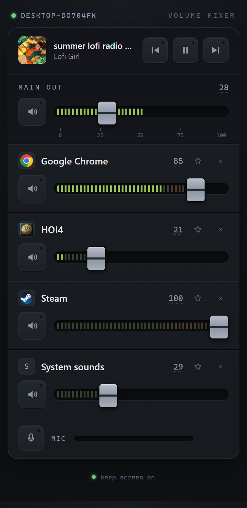

# Volume Mixer

Control your Windows PC's sound from your phone: per-app faders with live meters, master volume, mic mute, now-playing with media keys, output switching. No app to install, no account, no cloud. It runs over your own Wi-Fi.

[](https://github.com/pierresaid/volume-mixer/actions/workflows/build.yml)



## Get started

1. **[Download `VolumeMixer.exe`](../../releases/latest)** on your PC and run it.
2. Click **Allow** if Windows Firewall asks.
3. **Scan the QR code with your phone's camera.** Done.

Windows 10/11 · any phone browser · same Wi-Fi.

> SmartScreen may warn the first time (the exe isn't code-signed): **More info → Run anyway**, or build from source below.

## Good to know

- Everything syncs both ways, live. Change something on the PC and the phone follows, and apps appear and disappear as they start and stop playing.
- It reconnects by itself. Lock your phone for an hour, come back: live again in a second.
- Pairing is a secret token inside the QR, so nobody on your Wi-Fi can control your audio without scanning it. Reset it anytime from the tray.
- It lives in the tray, can start with Windows, and is one self-contained exe.

<br clear="right">

<details>
<summary><b>Troubleshooting</b></summary>
<br>

| Symptom | Fix |
|---|---|
| The page won't load on the phone | Same Wi-Fi? Guest networks and router “AP/client isolation” block phone↔PC traffic. |
| It worked before, now it doesn't | The PC probably got a new IP (the tray warns you). Re-scan the QR, or give the PC a DHCP reservation and it never happens again. |
| You clicked *Cancel* on the firewall prompt | That silently blocks the app forever. Tray → **Fix firewall (admin)** repairs it in one click. |
| “This phone isn't paired” | Pairing was reset on the PC. Re-scan the QR code. |
| Tray says it's using a different port | Port 6002 was taken, so the next free one was used. Re-scan the QR and the phone learns it. |

</details>

## Development

One .NET 10 tray exe (Kestrel + SignalR + NAudio) serves the Vue client embedded inside it. State is event-driven with a full snapshot on every reconnect, and it's plain HTTP on the LAN by design: the pairing token is the lock, since browsers can't pin self-signed certificates. Design notes: [docs/DESIGN.md](docs/DESIGN.md).

```sh
cd client && npm install && npm run build   # build the phone UI into the server
cd ../server/VolumeMixer && dotnet run      # tray icon + QR window appear
```

For UI work, keep `dotnet run` running and use `npm run dev`. Vite proxies to `localhost:6002` with hot reload.

To release, push a version tag (`git tag v1.2.0 && git push origin v1.2.0`). CI builds the exe with that version and publishes it with its SHA-256 and a signed build-provenance attestation. The version in the repo stays `0.0.0-dev`, and a tag like `v1.2.0-beta.1` becomes a prerelease.

[MIT](LICENSE)
